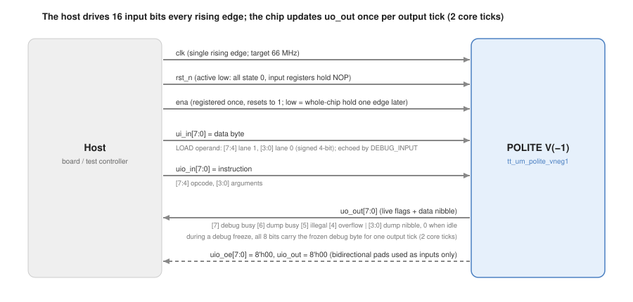
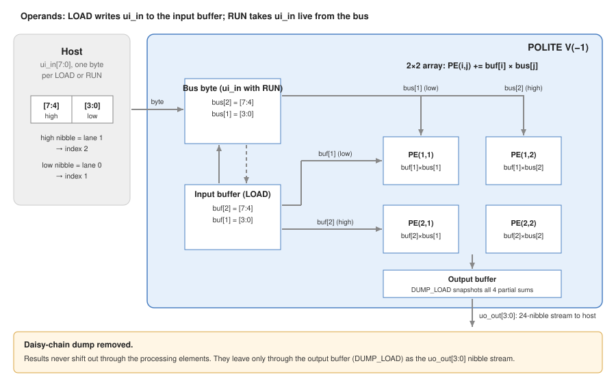

# POLITE V(−1) — Architecture and Instruction Set Specification

| | |
|---|---|
| Chip | POLITE V(−1), Tiny Tapeout demonstration chip |
| Document | Architecture and instruction set architecture (ISA) specification |
| Date | 2026-11-01 (US Central) |

## 1. Overview

POLITE V(−1) is a 2×2 array of signed 4-bit integer (int4) multiply-accumulate units, called processing elements. Each processing element multiplies one int4 value from a left input buffer by one int4 value from a top input buffer and adds the product into its own 24-bit signed partial sum. The four processing elements together compute a 2×2 outer product per step, so repeated steps build up a small matrix multiply.

The chip deliberately does only the multiply-accumulate. Everything that turns a raw integer sum into a usable result — scale, zero point, rectified linear unit (ReLU) and bias — is the host's job. There is no on-chip ReLU, bias or scale. This keeps the silicon small and keeps the arithmetic exact: what comes out is the true wrapped 24-bit sum, and the host applies whatever post-processing its number format needs.

The chip has an output buffer. When the host asks for results, the four partial sums are copied into that buffer and streamed out from there, so the processing elements are free to keep accumulating while the previous results are still leaving the chip. Computing and reading out can overlap instead of taking turns.

From the host's point of view the interface is synchronous. Every clock, the host drives one data byte and one instruction byte. In return it reads 8 output bits: a 4-bit data nibble plus 4 live status flags. The inputs are sampled on every clock, but the outputs update only once per *beat* (2 clocks), because the output pads are run at half the core rate (Section 2).

Terms used below:

| Term | Meaning |
|---|---|
| Processing element (PE) | One of the four multiply-accumulate cells, named PE(row, column) |
| Multiply-accumulate (MAC) | Multiply two int4 values and add the product to a running sum |
| Partial sum | The 24-bit signed running sum held in each processing element |
| Output buffer | Copy of the four partial sums that the dump stream reads from |
| Beat | One output update period: 2 clocks (30.30 ns). `uo_out` changes at most once per beat |
| Freeze | The single beat in which a debug read owns all 8 output pins; the next beat returns to live output |
| Core edge | One rising edge of the 66 MHz clock. "Edge", "clock" and "cycle" below all mean one core edge |
| Output tick | Every second core edge, counted from reset; the output pins load on the edge after an output tick, and the dump advances only on output ticks |
| RUN phase 1 / phase 2 | First and second clock of a RUN |
| Other short names | inbuf / outbuf = input / output buffer; OVF = overflow; DBG_* = DEBUG_* |

## 2. Pins and clock

| Pin | Direction | Meaning |
|---|---|---|
| `clk` | input | Single rising-edge clock, 66 MHz target |
| `rst_n` | input | Active-low reset: all state 0, inputs read as NOP, chip enabled |
| `ena` | input | Enable; low holds the whole chip, taking effect one edge after the pin changes |
| `ui_in[7:0]` | input | Data byte (used by LOAD, echoed by DEBUG_INPUT) |
| `uio_in[7:4]` | input | Opcode |
| `uio_in[3:0]` | input | Opcode arguments |
| `uo_out[3:0]` | output | Data nibble (dump stream; 0 when idle) |
| `uo_out[7:4]` | output | Live flags, one per bit: • bit 4: overflow. • bit 5: illegal. • bit 6: dump busy at the start of the displayed edge; on unfrozen beats, 1 exactly when `uo[3:0]` is a dump nibble (frozen beats show debug byte bits). • bit 7: reads 0 when live; not a debug-busy pin (debug busy is bit 3 of a frozen DEBUG_FLAGS byte). |

The `uio` pads are bidirectional in the Tiny Tapeout package, but this design drives `uio_oe = 0` on all 8 bits and ties `uio_out` to 0, so they are used as inputs only. All 16 input bits (`ui_in` and `uio_in`) are sampled on every rising edge, so the host must present a valid instruction on every clock; when it has nothing to do, it drives NOP (0x00).

Figure 1: pins between the host and the chip

Normally `uo_out` shows the data nibble and the live flags. A freezing debug read takes over all 8 output bits for exactly one beat (one output update, 2 clocks) to show a single debug byte (Section 5.6); on the very next beat the pins return to the live nibble and flags. No debug read holds the outputs longer than that.

**Clock.** The chip uses a single rising-edge clock. The core logic and input sampling run at 66 MHz (a 15.15 ns clock). The output pads are slower than the core, so the outputs are allowed to change at no more than 33 MHz. Counting edges from reset, every second edge is an *output tick*. `uo_out` is updated only on the edge right after an output tick, so each value it shows is held stable for one full beat (2 clocks). This gives the output pads and the host's input sampling twice as much time as a full-rate output would; the host may treat `uo_out` as a 33 MHz signal sampled once per beat.

Because outputs move once per beat, anything the chip produces — a dump nibble or a debug byte — occupies exactly one beat at the pins. The dump stream advances once per output tick for the same reason: one nibble per beat.

**Pad pipeline.** Inputs and outputs are both registered at the pins, which adds a small, fixed latency between the host and the core. `ui_in` and `uio_in` are sampled on edge k and the command executes in the core on edge k+1. All 8 `uo_out` bits update together, once per beat. So an operation applied before edge k executes on edge k+1, and its result appears on `uo_out` after edge k+2 when edge k+1 is an output tick, or after edge k+3 otherwise. The one-edge difference is whether the result has to wait for the next output update.

The host can know which case it is in by counting clocks from reset, since output ticks alternate starting from reset. A host that does not want to track the phase can always read after edge k+3, which is safe in both cases. Reset makes the inputs read as NOP and drives `uo_out` to 0, so the chip comes out of reset idle with all-zero outputs. A hold driven by `ena` takes effect one edge after the pin changes (Section 8).

The rest of this document describes behavior one edge at a time *inside the core*, because that is where the rules are simplest to state. To translate any of it to pin timing, add the pad latency (2 or 3 edges, as above) and remember that the outputs update only once per beat.

## 3. Commands

A command is one 8-bit instruction byte on `uio_in`: bits [7:4] are the opcode and bits [3:0] are its arguments. A new command can be given on every rising edge; there is no handshake and no instruction queue. Commands that need more than one edge (RUN, the dump stream, a debug freeze) carry on by themselves, and the rules in Section 5 say which commands may overlap with them.

| Op | Name | What it does | Freezes output? |
|---|---|---|---|
| 0x0 | NOP | Nothing; the dump stream and flags keep flowing | no |
| 0x1 | LOAD | Shift `ui_in` into the input buffer (1 edge) | no |
| 0x2 | RUN | One multiply-accumulate step (2 edges) | no |
| 0x3 | DUMP_LOAD | Copy the partial sums to the output buffer and start the 24-nibble stream | no |
| 0x4 | DUMP_ABORT | Stop the stream; dump busy = 0 | no |
| 0x5 | CLEAR | Zero the selected state; any conflict ignores the whole CLEAR and sets illegal | no |
| 0x6 | DEBUG_FLAGS | Return the 8-bit flag byte (Section 5.6) | yes, 1 beat |
| 0x7 | DEBUG_BUFFER | Return the left or top input buffer byte | yes, 1 beat |
| 0x8 | DEBUG_PARTIAL_SUM | Return one byte of a 24-bit partial sum | yes, 1 beat (3 commands for 24 bits) |
| 0x9 | DEBUG_MULTIPLY | Return the last product, sign-extended to 8 bits | yes, 1 beat (full product) |
| 0xA | DEBUG_ADD | Return one byte of the 24-bit wrapped adder output (Section 5.7) | yes, 1 beat (3 commands for 24 bits) |
| 0xB | DEBUG_INPUT | Return the sampled `ui_in` byte | yes, 1 beat |
| 0xC–0xF | — | Reserved; illegal on this chip: set the illegal flag | no |

| Command | Argument bits |
|---|---|
| NOP, LOAD, RUN, DUMP_LOAD, DUMP_ABORT, DEBUG_INPUT | [3:0] reserved, drive 0 |
| CLEAR | [3] partial sums, [2] output buffer, [1] input buffer (left and top), [0] flags (overflow and illegal); any combination |
| DEBUG_FLAGS | [3:0] bank select; only bank 0 is defined on this chip, other banks are reserved for future flag expansion (Section 4) |
| DEBUG_BUFFER | [3:1] reserved, [0] buffer (0 = left, 1 = top) |
| DEBUG_PARTIAL_SUM | [3:2] byte (0 = bits 7:0, 1 = bits 15:8, 2 = bits 23:16), [1:0] processing element |
| DEBUG_MULTIPLY | [3:2] reserved, [1:0] processing element |
| DEBUG_ADD | [3:2] byte (0 = bits 7:0, 1 = bits 15:8, 2 = bits 23:16), [1:0] processing element |

Whenever a command takes a processing element index, the index sits in bits [1:0]. Only DEBUG_PARTIAL_SUM and DEBUG_ADD use bits [3:2], as their byte select; CLEAR uses all four bits as a mask. The processing element index is also the dump order: 0 = PE(2,2), 1 = PE(2,1), 2 = PE(1,2), 3 = PE(1,1). Using one numbering everywhere means a host can read a dumped sum and then inspect the same processing element with a debug read without translating indices.

Every freezing debug read owns the output pins for exactly one beat. DEBUG_ADD and DEBUG_BUFFER are no exception: each shows its byte on all 8 `uo_out` bits for one beat and then releases the pins to the live nibble and flags.

**Reserved opcodes.** Opcodes 0xC–0xF are reserved expansion slots. They may be filled in a future build with additional debug or conventional commands, if such commands prove useful for testing or operation. On this chip they remain illegal: each sets the illegal flag and has no other effect. A host must not issue them, and must not assume any of them will ever become legal.

Three argument values are rejected rather than ignored: DEBUG_FLAGS with bank ≠ 0, DEBUG_PARTIAL_SUM with byte 3, and DEBUG_ADD with byte 3. Each sets the illegal flag and does **not** freeze the outputs, so the host sees live output on that beat instead of a meaningless byte. Reserved bits, by contrast, are ignored by this revision; drive them to 0.

## 4. Flags

The chip keeps six status flags. Four of them are live on the output pins on every beat that is not frozen, so the host can watch for errors and dump progress without spending any commands. All six can be read at once with DEBUG_FLAGS (Section 5.6).

| Flag | Kind | Set by | Cleared by |
|---|---|---|---|
| Overflow | sticky | a 24-bit accumulate wrapping around | CLEAR bit 0 |
| Illegal | sticky | an illegal opcode (0xC–0xF, reserved; Section 3); RUN on RUN phase 2; DUMP_LOAD while a dump is in progress; a CLEAR conflict (Section 5.3); DEBUG_FLAGS bank ≠ 0; DEBUG_PARTIAL_SUM byte 3; DEBUG_ADD byte 3 | CLEAR bit 0 |
| Dump busy | level | DUMP_LOAD | end of stream, DUMP_ABORT |
| Debug busy | level | a freezing debug read; reads 1 as bit 3 of the frozen debug byte, which is on the pins for exactly one beat | the end of that beat |
| Run busy | level | RUN phase 1 | end of RUN phase 2 |
| Dump paused | level | a freezing debug read during an active dump; the dump does not advance on the frozen beat. Visible only in a DEBUG_FLAGS frozen byte (bit 5) | end of the freeze |

*Sticky* means the flag stays set until the host clears it with CLEAR bit 0, no matter how much time passes. This matters for a host that polls only occasionally: an overflow or a rejected command is never lost just because the host looked at the pins a few beats too late. *Level* flags, by contrast, simply report what the chip is doing right now.

Reset clears every flag and all chip state. The live pins `uo[7:4]` carry the first four flags; run busy and dump paused are visible only through DEBUG_FLAGS. Note that on a frozen beat the upper pins carry bits of the debug byte, not the live flags, so a host watching `uo_out[7:4]` should skip the beats it froze itself.

**Room to grow.** The current iteration of this chip has only one bank, bank 0 (layout in Section 5.6). DEBUG_FLAGS is intended to allow expansion: if RTL, verification, or physical design deem more flags useful, extra flags and banks may be added in a future iteration. Each bank is its own 8-bit flag byte, and the host selects which bank to read with the DEBUG_FLAGS argument bits [3:0]. Banks are a build-time expansion path, so a host driver written today keeps working unchanged — it simply keeps asking for bank 0. Any other bank is undefined and illegal on this chip, and a host must not assume a given bank will ever become legal: it sets the illegal flag and does **not** freeze the outputs, so the host sees live output on that beat. Bank 0 is a normal freezing read of exactly one beat.

## 5. Behavior for host software

### 5.1 RUN
RUN is one full multiply-accumulate step and takes 2 clocks. On RUN phase 1 (the first clock) the chip computes the four products from the current input buffers. On RUN phase 2 (the second clock) it adds them to the partial sums, wrapping at 24 bits, and clears the products to 0.

Because the adders are still busy on phase 2, a RUN that arrives on phase 2 of a previous RUN is ignored and sets the illegal flag; it is not queued. The maximum rate is therefore one RUN every 2 clocks: `RUN, NOP, RUN, NOP, …`. Any opcode other than RUN can fill the gap, including LOAD; a LOAD there does not affect the RUN in flight, because phase 2 only adds the products latched on phase 1. Note that one LOAD shifts both buffers (Section 6.1), so a single gap LOAD does not stage a fresh, independent left/top pair: loading a fresh pair takes two LOADs, which needs a gap of at least 2 edges and so drops the rate below one RUN every 2 clocks.

In regular use, RUN is expected to be paired with LOAD in the rhythm `RUN, LOAD, RUN, LOAD, RUN, LOAD, …`. The LOAD occupies the gap that RUN phase 2 forces anyway and stages operands for the next RUN, so the array is kept at its maximum rate of one RUN every 2 clocks. Each gap LOAD advances the load shift by exactly one byte: the previous left byte moves to top and the new byte enters left (Section 6.1). Consecutive RUNs in this rhythm therefore see overlapping operand pairs, which suits a host that packs its stream so that each new byte is the next operand it wants. When the host needs a fresh, fully independent left/top pair, that pair takes two LOADs, i.e. two such gaps (or one wider gap), as stated above.

This pairing spends an issue slot on LOAD. A single fused command that loaded operands and performed the multiply-accumulate, taking two cycles to process both, would remove the separate LOAD instruction and its issue slot. This chip is a test chip, however, and producing a design that works in the end has priority over that optimization. Keeping LOAD and RUN as separate, simple commands keeps each one easy to verify on its own and leaves the fused form as a candidate for a later revision.

On RUN phase 2 the RUN still counts as in progress. Other opcodes executed on that cycle see run busy = 1 and see the partial sums as they were *before* the add; the add takes effect at the end of the cycle. Section 5.7 lists exactly which reads see the pre-add and which see the post-add values on that cycle.

RUN is allowed during a debug freeze. A freeze only affects what the output pins show; it does not stop the datapath.

### 5.2 DUMP_LOAD and DUMP_ABORT
DUMP_LOAD is how results leave the chip. It copies the four partial sums into the output buffer in one edge and then streams them out as 24 nibbles, one per output tick (one per beat), starting at the first output tick after the DUMP_LOAD edge. While the stream runs, dump busy is high; a complete dump keeps it high for 48 clocks (49 if DUMP_LOAD lands on an output tick, because the first nibble then waits for the next tick). Since the stream reads from the output buffer and not from the processing elements, RUNs can continue during the stream without affecting it. A typical schedule is: finish a tile of RUNs, DUMP_LOAD, clear the partial sums on the edge after DUMP_LOAD, and start accumulating the next tile while the previous one streams out.

- DUMP_LOAD is **illegal while a dump is in progress** at the start of the cycle, including the cycle that sends the last nibble. It does not restart the stream; the current stream finishes normally, and the illegal flag records that the request was refused. This prevents a late DUMP_LOAD from silently overwriting results the host is still receiving.
- DUMP_LOAD on RUN phase 2 captures the result of that RUN, so the host does not need an extra idle clock between the last RUN and the dump. The overflow flag is still set only once, by the RUN itself.
- DUMP_ABORT stops the stream; dump busy drops to 0. DUMP_ABORT with no dump running is a legal no-op (illegal is not set), so a host can issue it unconditionally as part of a recovery sequence.

**Reading the stream at the pins.** The host does not need a separate "data valid" pin: `uo_out[6]` (dump busy) serves as the frame marker. The dump nibbles are, in order, the beats on which `uo_out[6]` = 1 and that are not frozen by a debug read. The DUMP_LOAD beat itself shows bit 6 = 0, the beat carrying the last nibble shows bit 6 = 1, and the beat after it shows 0, on either beat phase. No pin marks a frozen beat (live `uo_out[7]` is 0), so the host must track its own freezing debug reads: for each freezing DBG_* applied before edge j (Section 2 numbering), the beat that contains the `uo_out` value after edge j+3 is frozen and is not a dump nibble even if bit 6 reads 1. Collect `uo_out[3:0]` on beats where bit 6 is set, minus those frozen beats, and **count exactly 24 nibbles**. For a visible gap between dumps, NOP until a clear bit-6 = 0 beat before the next DUMP_LOAD. After DUMP_ABORT, wait at least 1 beat (2 clocks) before DUMP_LOAD; the ABORT beat's bit 6 is phase-dependent. Without debug reads the host does not need to track the beat phase. Nibble 0 is on the pins 3 or 4 edges after DUMP_LOAD is applied.

There is no separate plain DUMP opcode; every dump goes through the output buffer.

### 5.3 CLEAR
CLEAR zeroes chosen parts of the chip state. Its arguments are a bit mask, and any combination is allowed: bit 0 clears the flags (overflow and illegal), bit 1 the input buffer (left and top), bit 2 the output buffer, bit 3 the partial sums.

Some clears would destroy work that is still in progress. If any selected bit conflicts, the **whole** CLEAR is ignored — including its non-conflicting bits — and the illegal flag is set:

- Bit 3 (partial sums) while a RUN is in progress, including RUN phase 2.
- Bit 2 (output buffer) while a dump was in progress at the start of the cycle, including the last-nibble cycle.

The all-or-nothing rule is intentional. If a CLEAR could partly succeed, the host would have to read back the state to find out which parts were actually cleared. With all-or-nothing, the host only has to check one thing — the illegal flag — and if it is clear, every bit it asked for took effect. One consequence is worth spelling out: a CLEAR that includes bit 0 and is rejected does not clear the flags, so the illegal flag it sets remains visible.

If RUN phase 2 overflows on the same cycle as a CLEAR of the flags, the new overflow stays set while earlier overflow and illegal are cleared. The newest event wins, so an overflow is never erased by a clear that happened to land on the same edge.

### 5.4 Sticky flags
Overflow and illegal stay set until CLEAR bit 0. Repeated illegal events leave the flag at 1; the chip does not count events. A host that needs to know *which* command was rejected should check the flag after each risky command instead of at the end of a long sequence.

### 5.5 Idle output
When no dump is running and no debug freeze is showing, the data nibble `uo[3:0]` is 0 and the flags in `uo[7:4]` stay live. A host can therefore leave the chip idle and keep watching the flag pins with no extra commands.

### 5.6 Debug reads
Debug reads let the host inspect internal state through the same 8 output pins that normally carry the dump stream and flags. A freezing debug read — every legal debug opcode, including DEBUG_ADD and DEBUG_BUFFER — owns all 8 `uo_out` bits for **exactly one beat**: one output update, 2 clocks. That beat shows the debug byte (DEBUG_FLAGS reports debug busy = 1 in bit 3 of it). The next beat returns to the live nibble and flags without any further command. A debug read never holds the pins for a second beat, and there is no multi-beat capture mode.

Two freezing reads on consecutive edges are not supported. Both would land in the same beat, but a beat carries only one byte, so which byte reaches the pins would depend on the beat phase. Space debug reads at least one beat (2 clocks) apart: opcode, NOP. Spaced reads always return one byte per beat, in order. The spacing rule is the cost of half-rate outputs: the pins can carry only one byte per beat, so the host cannot request bytes faster than that.

DEBUG_FLAGS bank 0 bit layout:

| Bit | Meaning |
|---|---|
| 0 | Overflow |
| 1 | Illegal |
| 2 | Dump busy |
| 3 | Debug busy (reads 1 in the frozen byte) |
| 4 | Run busy |
| 5 | Dump paused |
| 6 | Reserved (reads 0) |
| 7 | Output buffer present (always 1) |

- Dump busy reports the state at the start of the cycle. A freeze during a dump also shows dump paused = 1, so the two bits agree even on the last-nibble cycle.
- On RUN phase 2, run busy = 1, and bit 0 includes any overflow from the add that finishes on that cycle.

Bit 6 is reserved and reads 0. Bit 7 is a fixed identity bit that reads 1 (output buffer present); a host driver can read DEBUG_FLAGS once after reset to confirm it is talking to this chip.

#### 5.6.1 Debug read latency and width

One debug opcode produces one freeze, and one freeze returns one byte. There is no multi-byte burst; values wider than 8 bits are read with several opcodes. At the pins, an opcode sampled on rising edge k shows its byte on `uo_out` after edge k+2 or k+3, depending on the beat phase, and holds it for one beat (2 clocks). This is the same pad pipeline as in Section 2. Reading `uo_out` after edge k+3 always returns the byte, so a host that does not track the phase can use that as its read point. Issue debug opcodes at least one beat (2 clocks) apart: opcode, NOP; each returns its byte one beat after the previous one.

| Opcode | Width per freeze | Opcodes for the full value | Byte visible at pins (opcode sampled on edge k) |
|---|---|---|---|
| DEBUG_FLAGS | 8 bits | 1 | after edge k+2 or k+3 |
| DEBUG_BUFFER | 8 bits (left or top) | 1 | after edge k+2 or k+3 |
| DEBUG_PARTIAL_SUM | 8 of 24 bits (argument picks byte 0, 1 or 2) | 3 | issued on edges k, k+2, k+4: one byte per beat, visible after edges k+2/k+3, k+4/k+5, k+6/k+7 depending on the beat phase; read after k+3, k+5, k+7 to be safe |
| DEBUG_MULTIPLY | full 8-bit product (int4 × int4, sign-extended) | 1 | after edge k+2 or k+3 |
| DEBUG_ADD | 8 of 24 bits of the wrapped sum (argument picks byte 0, 1 or 2) | 3 | as DEBUG_PARTIAL_SUM: issued on edges k, k+2, k+4, one byte per beat; read after k+3, k+5, k+7 to be safe |
| DEBUG_INPUT | 8 bits | 1 | after edge k+2 or k+3 |

DEBUG_PARTIAL_SUM and DEBUG_ADD each return a 24-bit value as three one-beat byte reads, with an opcode and a NOP per beat. If a RUN completes or a partial-sum CLEAR lands between those three reads, the bytes come from different values; hold off RUNs and partial-sum CLEARs if the host needs a consistent 24-bit value. The three DEBUG_ADD freezes necessarily land on different cycles, so a host cannot capture a full 24-bit in-progress add preview in one moment: it gets only three spaced one-beat reads, and outside RUN phase 2 those bytes simply match the partial sum.

Figure 2: debug reads at the pins, one byte per opcode, held for one beat (2 clocks)

**Dump pause.** A debug read and the dump stream share the same pins, so they cannot both use the same beat. Only a debug read that actually freezes the output pauses the dump. The stream does not advance on any output tick covered by the freeze (dump paused = 1), and it resumes on the next output tick that is not frozen. No nibbles are lost; the dump simply takes one beat longer for each freeze. This is why the framing rule in Section 5.2 says to skip frozen beats: the frozen beat carries the debug byte, and the nibble that would have gone out is sent on the following beat instead. An illegal debug read that does not freeze (DEBUG_FLAGS bank ≠ 0, DEBUG_PARTIAL_SUM byte 3, DEBUG_ADD byte 3) does not pause: the nibble goes out on schedule and the stream stays complete.

### 5.7 Debug reads on RUN phase 2
RUN phase 2 is the one cycle on which a value is changing inside the processing elements, so it is the one cycle where "which value does this read see?" needs a precise answer.

- DEBUG_PARTIAL_SUM and DEBUG_MULTIPLY return the registers as they are before the add.
- DEBUG_ADD returns a preview of the result: the selected byte of the 24-bit wrapped sum of partial sum plus product. At other times each byte is the corresponding byte of the current partial sum (the product is 0 after a finished RUN). It never sets overflow.
- DEBUG_FLAGS returns the start-of-cycle busy flags plus any overflow from the add.

The rule behind these cases: reads that report the adder output or a value latched on this edge (DEBUG_ADD, DEBUG_FLAGS overflow, DUMP_LOAD capture) see the add. Plain register reads see the values before it.

## 6. Datapath

### 6.1 LOAD packing
A LOAD byte holds two signed int4 lanes: the high nibble is lane 1 and the low nibble is lane 0. Each input buffer is one such byte, giving the two values for one side of the 2×2 array. LOAD shifts the input buffers by one byte, so the host fills both buffers with two consecutive LOADs:

Each LOAD moves the old left byte to top and writes the new byte into left. So the first byte of a pair ends up in top and the second in left. This order is fixed; the host cannot change it. Physically, the input buffer feeding the array sits on the side of the floorplan furthest from the input pads, a placement chosen because layout showed no preference between left and top. A host can verify the result with DEBUG_BUFFER before running.

Figure 3: LOAD path. High nibble [7:4] is lane 1 (index 2), low nibble [3:0] is lane 0 (index 1). Results leave through the output buffer (DUMP_LOAD).

### 6.2 Accumulate
Each RUN performs `PE(i,j) += left[i] × top[j]`, with i, j ∈ {1, 2}; lane 0 is index 1 and lane 1 is index 2. The product of two int4 values always fits in 8 signed bits. Partial sums are 24-bit two's complement and wrap around on overflow rather than saturating; any wrap sets the sticky overflow flag. A host that sees overflow set knows that at least one add wrapped since the flags were last cleared, so the sums may not equal the true mathematical result (the flag is sticky: a later opposite wrap may have restored a sum, or the flag may be left over from an earlier tile) and can decide whether to discard or rescale the tile.

### 6.3 Dump stream order
A dump is 24 nibbles = 4 processing elements × 6 nibbles each:

- Processing element order: (2,2), (2,1), (1,2), (1,1) — the same as the processing element index in Section 3.
- Within each 24-bit partial sum: **little-endian, low nibble first**.

Host reconstruction: for nibble n (0..23), `sum[n/6] |= nibble << (4*(n%6))`, where `n/6` is integer division (processing element order above) and `sum` starts at 0. Then sign-extend each sum from bit 23: `if (sum & 0x800000) sum -= 0x1000000` (equivalently `sum |= ~0xFFFFFF` in a 32-bit signed integer).

## 7. Verification

Packaging: the design does not fit a Tiny Tapeout 1×1 tile, so it uses a 1×2 tile.

Functional verification is current. Verified at commit `677ce98`: the hardware design matches the reference model (`golden/chip.c`) cycle for cycle on `uo_out` in random simulation; the reference model self-test `gcc -Wall -O2 -o chip_test golden/chip.c && ./chip_test` reports ALL PASS; and the adversarial suite, including round R7, passes 70 / 0 / 0 (pass / fail / gap).

## 8. Open items

- DEBUG_FLAGS banks other than 0 are undefined and illegal (reserved for future testing-flag expansion, Section 4).
- The reference model does not model `ena`. Behavior at the pins: a hold takes effect one edge after `ena` goes low and ends one edge after it goes high; the edges in between are *hold edges*. Commands presented only during hold edges are **not** sampled; whatever is on the pads on the first enabled edge after the hold is what gets captured. All state, including the beat phase, freezes while held and resumes where it stopped, so a host tracking beat phase by counting clocks should not count hold edges.

## 9. References

- `docs/LOCKS.md` — design decisions
- `docs/OPCODE_PROPOSAL.md` — opcode table
- `LESSONS.md` — edge-case findings
- `golden/chip.c` — cycle-level reference model
