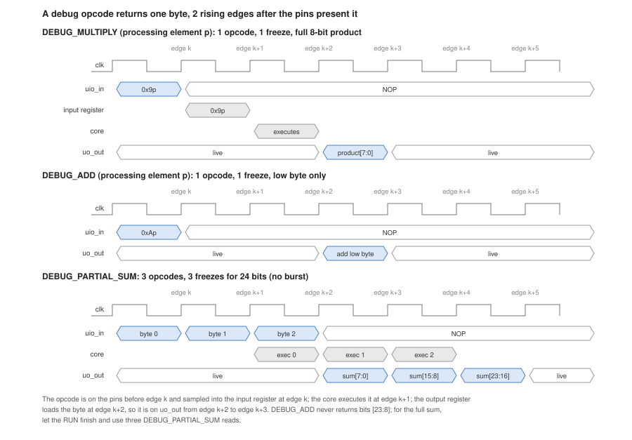

# POLITE Mini — Architecture and Instruction Set Specification

Table 1: document information

| | |
|---|---|
| Chip | POLITE Mini, Tiny Tapeout demonstration chip |
| Document | Architecture and instruction set architecture (ISA) specification |
| Date | 2026-11-02 (US Central) |

## 1. Overview

POLITE Mini is a 2×2 array of signed 4-bit integer (int4) multiply-accumulate units, called processing elements. Each processing element multiplies one int4 value from the input buffer by one int4 value taken live from the `ui_in` data bus on the RUN core tick and adds the product into its own 24-bit signed partial sum. The four processing elements together compute a 2×2 outer product per step, so repeated steps build up a small matrix multiply.

The chip deliberately does only the multiply-accumulate. Everything that turns a raw integer sum into a usable result — scale, zero point, rectified linear unit (ReLU) and bias — is the host's job. There is no on-chip ReLU, bias or scale. This keeps the silicon small and keeps the arithmetic exact: what comes out is the true wrapped 24-bit sum, and the host applies whatever post-processing its number format needs.

The chip has an output buffer. When the host asks for results, the four partial sums are copied into that buffer and streamed out from there, so the processing elements are free to keep accumulating while the previous results are still leaving the chip. Computing and reading out can overlap instead of taking turns.

From the host's point of view the interface is synchronous. Every clock, the host drives one data byte and one instruction byte. In return it reads 8 output bits: a 4-bit data nibble plus 4 live status flags. The inputs are sampled on every *core tick*, but the outputs update only once per *output tick* (every second core tick), because the output pads are run at half the core rate (Section 2).

Terms used below:

Table 2: terms used in this specification

| Term | Meaning |
|---|---|
| Processing element (PE) | One of the four multiply-accumulate cells, named PE(row, column) |
| Multiply-accumulate (MAC) | Multiply two int4 values and add the product to a running sum |
| Partial sum | The 24-bit signed running sum held in each processing element |
| Output buffer | Copy of the four partial sums that the dump stream reads from |
| Core tick | One rising edge of the 66 MHz core clock (15.15 ns). "Edge", "clock" and "cycle" below all mean one core tick |
| Output tick | One update of `uo_out`: every second core tick (33 MHz, 30.30 ns per value). Each value on `uo_out` is held for one output tick, i.e. 2 core ticks. Output ticks are counted from reset; the dump advances once per output tick |
| Freeze | The run of core ticks in which a debug read streams nibbles on `uo_out[3:0]` while `uo_out[7:4]` stay live. An 8-bit read streams 2 nibbles over 4 core ticks; a 24-bit read streams 6 nibbles over 12 core ticks. The freeze window, during which RUN and a second debug read are illegal, is defined in Sections 5.1 and 5.6 |
| RUN phase 1 / phase 2 | The two pipeline stages of one RUN: phase 1 (multiply) on the core tick the RUN executes, phase 2 (accumulate) on the next core tick. Phase 1 of a new RUN may overlap phase 2 of the previous one (Section 5.1) |
| Other short names | inbuf / outbuf = input / output buffer; OVF = overflow; DBG_* = DEBUG_* |

## 2. Pins and clock

Table 3: pin list

| Pin | Direction | Meaning |
|---|---|---|
| `clk` | input | Single rising-edge clock, 66 MHz target |
| `rst_n` | input | Active-low reset: all state 0, inputs read as NOP, chip enabled |
| `ena` | input | Enable; low holds the whole chip, taking effect one edge after the pin changes |
| `ui_in[7:0]` | input | Data byte: written to the input buffer by LOAD, used as the bus operand by RUN, echoed by DEBUG_INPUT |
| `uio_in[7:4]` | input | Opcode |
| `uio_in[3:0]` | input | Opcode arguments |
| `uo_out[3:0]` | output | Data nibble. A dump nibble when bit 6 is 1, a debug nibble when bit 7 is 1, and 0 when idle |
| `uo_out[7:4]` | output | Live on every output tick, including during a debug freeze: • bit 4: overflow, including an in-flight phase-2 overflow. • bit 5: illegal. • bit 6: dump-nibble marker. This is dump busy at the start of the displayed edge, forced to 0 on a debug-nibble output tick. • bit 7: debug-nibble marker. It is 1 exactly on a debug-nibble output tick. On a non-debug-nibble output tick, live `uo_out[7]` is 0. |

The `uio` pads are bidirectional in the Tiny Tapeout package, but this design drives `uio_oe = 0` on all 8 bits and ties `uio_out` to 0, so they are used as inputs only. All 16 input bits (`ui_in` and `uio_in`) are sampled on every rising edge, so the host must present a valid instruction on every clock; when it has nothing to do, it drives NOP (0x00).

Figure 1: pins between the host and the chip

Normally `uo_out` shows a data nibble and the live upper bits. A freezing debug read does not take over the upper pins. It streams the captured value as nibbles on `uo_out[3:0]`, low nibble first, one nibble per output tick: two output ticks for an 8-bit value and six for a 24-bit value. On each of those output ticks bit 7 is 1 and bit 6 is forced to 0, while bit 5 and bit 4 keep showing illegal and overflow. Length, order and spacing are defined in Section 5.6.

**Clock.** The chip uses a single rising-edge clock. The core logic and input sampling run at 66 MHz (a 15.15 ns clock). The output pads are slower than the core, so the outputs are allowed to change at no more than 33 MHz. Counting core ticks from reset, every second one is an *output tick*: `uo_out` is loaded only on the core tick right after an output-tick marker, so each value it shows is held stable for 2 core ticks. This gives the output pads and the host's input sampling twice as much time as a full-rate output would; the host may treat `uo_out` as a 33 MHz signal sampled once per output tick.

Because outputs move once per output tick, each item the chip produces — a dump nibble or one debug nibble — occupies exactly one output tick at the pins. The dump stream advances once per output tick for the same reason, and it does not advance on a debug-nibble output tick.

**Pad pipeline.** Inputs and outputs are both registered at the pins, which adds a small, fixed latency between the host and the core. `ui_in` and `uio_in` are sampled on edge k and the command executes in the core on edge k+1. All 8 `uo_out` bits update together, once per output tick. So an operation applied before edge k executes on edge k+1, and its result appears on `uo_out` after edge k+2 when edge k+1 is an output tick, or after edge k+3 otherwise. The one-edge difference is whether the result has to wait for the next output update.

The host can know which case it is in by counting clocks from reset, since output ticks alternate starting from reset. A host that does not want to track the phase can always read after edge k+3, which is safe in both cases. Reset makes the inputs read as NOP and drives `uo_out` to 0, so the chip comes out of reset idle with all-zero outputs.

**Enable.** `ena` is sampled into a register on every rising edge, including hold edges, and that register resets to 1. The registered value is what gates the chip, so the effect lags the pin by one edge. The edge on which `ena` falls is still enabled: it samples `ui_in` and `uio_in` and runs. Every following edge is a hold until the edge after `ena` rises. The edge on which `ena` rises is still a hold. Hold edges do not sample the input pins, do not execute a command, and do not change any other state. The output-tick phase freezes with the rest of the chip and resumes on the next enabled edge, so a host that counts core ticks to track that phase must not count hold edges. The first enabled edge after a hold executes the command sampled on the last enabled edge, and captures the pins presented on that first enabled edge. Commands presented only on hold edges are not sampled. The reference model (`chip_step_ena`) follows this rule; `chip_step` drives `ena` high.

The rest of this document describes behavior one edge at a time *inside the core*, because that is where the rules are simplest to state. To translate any of it to pin timing, add the pad latency (2 or 3 core ticks, as above) and remember that the outputs update only once per output tick.

## 3. Commands

A command is one 8-bit instruction byte on `uio_in`: bits [7:4] are the opcode and bits [3:0] are its arguments. A new command can be given on every rising edge; there is no handshake and no instruction queue. Commands that need more than one core tick (RUN, the dump stream, a debug freeze) carry on by themselves, and the rules in Section 5 say which commands may overlap with them.

Table 4: opcode map

| Op | Name | What it does | Freezes output? |
|---|---|---|---|
| 0x0 | NOP | Nothing; the dump stream and flags keep flowing | no |
| 0x1 | LOAD | Write `ui_in` into the input buffer (1 edge) | no |
| 0x2 | RUN | One multiply-accumulate step: input buffer × `ui_in`; 2-stage pipeline, a new RUN may issue every core tick except inside a debug freeze window (Section 5.1) | no |
| 0x3 | DUMP_LOAD | Copy the partial sums to the output buffer and start the 24-nibble stream | no |
| 0x4 | DUMP_ABORT | Stop the stream; dump busy = 0 | no |
| 0x5 | CLEAR | Zero the selected state; any conflict ignores the whole CLEAR and sets illegal | no |
| 0x6 | DEBUG_FLAGS | Return one 8-bit status byte as two nibbles, low nibble first (Section 5.6) | yes, 2 output ticks |
| 0x7 | DEBUG_BUFFER | Return the input buffer byte as two nibbles, low nibble first | yes, 2 output ticks |
| 0x8 | DEBUG_PARTIAL_SUM | Return the full 24-bit partial sum as six nibbles, low nibble first | yes, 6 output ticks (all 24 bits from one command) |
| 0x9 | DEBUG_MULTIPLY | Return the last product as an 8-bit signed value, two nibbles (Section 6.2) | yes, 2 output ticks |
| 0xA | DEBUG_ADD | Return the full 24-bit wrapped adder output as six nibbles, low nibble first (Section 5.7) | yes, 6 output ticks (all 24 bits from one command) |
| 0xB | DEBUG_INPUT | Return the sampled `ui_in` byte as two nibbles, low nibble first | yes, 2 output ticks |
| 0xC–0xF | — | Reserved; illegal on this chip: set the illegal flag | no |

Table 5: argument bits per command

| Command | Argument bits |
|---|---|
| NOP, LOAD, RUN, DUMP_LOAD, DUMP_ABORT, DEBUG_BUFFER, DEBUG_INPUT | [3:0] reserved, drive 0 |
| CLEAR | [3] partial sums, [2] output buffer, [1] input buffer, [0] flags (overflow and illegal); any combination |
| DEBUG_FLAGS | [3:0] bank select; only bank 0 is defined on this chip (other banks: see below) |
| DEBUG_PARTIAL_SUM | [3:2] reserved, drive 0 (ignored); [1:0] processing element |
| DEBUG_MULTIPLY | [3:2] reserved, drive 0 (ignored); [1:0] processing element |
| DEBUG_ADD | [3:2] reserved, drive 0 (ignored); [1:0] processing element |

Whenever a command takes a processing element index, the index sits in bits [1:0]. No command uses bits [3:2] as a byte select: DEBUG_PARTIAL_SUM and DEBUG_ADD send all six nibbles of their 24-bit value from a single command, so there is nothing to select, and bits [3:2] are reserved for them. CLEAR uses all four bits as a mask, and DEBUG_FLAGS uses all four as a bank number. The processing element index is also the dump order: 0 = PE(2,2), 1 = PE(2,1), 2 = PE(1,2), 3 = PE(1,1). Using one numbering everywhere means a host can read a dumped sum and then inspect the same processing element with a debug read without translating indices.

**Reserved opcodes and bits.** Opcodes 0xC–0xF are illegal on this chip: each sets the illegal flag and has no other effect; a host must not issue them. Reserved argument bits are ignored; drive them to 0.

One argument case is rejected rather than ignored: DEBUG_FLAGS with bank ≠ 0 is illegal and does **not** freeze. It sets the sticky illegal flag and produces no debug nibbles. If a freeze is already streaming, that illegal bank does not restart it. A host must not assume any other bank will become legal.

## 4. Flags

The chip keeps six status flags. Together with the output-buffer occupancy bit and the output-tick phase bit they form one 8-bit status byte. DEBUG_FLAGS returns that byte as two nibbles, low nibble first (Section 5.6). The host can also watch the pins: bit 4 and bit 5 are overflow and illegal on every output tick, bit 6 marks a dump nibble, and bit 7 marks a debug nibble.

Table 6: status flags

Occupancy and output-tick phase live in the DEBUG_FLAGS data nibble (bits 3 and 2); see Section 5.6.

| Flag | Kind | Set by | Cleared by |
|---|---|---|---|
| Overflow | sticky | a 24-bit accumulate wrapping around | CLEAR bit 0 |
| Illegal | sticky | an illegal opcode (0xC–0xF, reserved; Section 3); DUMP_LOAD while a dump is in progress; a CLEAR conflict (Section 5.3); DEBUG_FLAGS bank ≠ 0; RUN inside a debug freeze window (Section 5.1); a second freezing debug read while a freeze is still open (Section 5.6) | CLEAR bit 0 |
| Dump busy | level | DUMP_LOAD | end of stream, DUMP_ABORT |
| Debug busy | level | a freezing debug read; bit 7 of the captured DEBUG_FLAGS byte is 1 for that read, and the flag stays high for the whole freeze (Section 5.6) | the end of the last debug-nibble output tick |
| Run busy | level | a RUN executing on the previous core tick (its phase 2 is in flight on this core tick; Section 5.1) | a core tick that follows a core tick with no RUN |
| Dump paused | level | a freezing debug read during an active dump; the dump does not advance on any debug-nibble output tick (Section 5.6.1). Visible in the DEBUG_FLAGS data nibble (bit 1) | end of the freeze |

*Sticky* means the flag stays set until the host clears it with CLEAR bit 0, no matter how much time passes. This matters for a host that polls only occasionally: an overflow or a rejected command is never lost just because the host looked at the pins a few output ticks too late. *Level* flags, by contrast, simply report what the chip is doing right now.

Reset clears every flag and all chip state. On this chip a DEBUG_FLAGS read after reset returns 0x80 when that core tick is not an output tick, and 0x84 when it is: bit 7 is debug busy because the read itself freezes, bit 3 is 0 because the output buffer is empty, and bit 2 is the output-tick phase. Bit 4 (overflow) and bit 5 (illegal) are also live on `uo_out` during the freeze. Bit 6 on the pins is the dump-nibble marker and is forced to 0 on each debug-nibble output tick, so it is not a copy of the captured status bit during those ticks. Bit 7 on the pins is the debug-nibble marker: it is 1 exactly on those ticks, and on a non-debug-nibble output tick, live `uo_out[7]` is 0.

**Room to grow.** This chip has one flag bank, bank 0 (layout in Section 5.6). Every bank keeps the same four base flags in bits [7:4]; a bank only changes the data nibble in bits [3:0]. The DEBUG_FLAGS bank argument is a build-time expansion path: a future chip may add banks, and a driver written today keeps working by asking for bank 0. Bank ≠ 0 is illegal and does not freeze.

## 5. Behavior for host software

### 5.1 RUN
RUN is one full multiply-accumulate step, executed as a two-stage pipeline. A RUN that executes on core tick t works like this:

- **Phase 1 (multiply), core tick t.** The chip samples the bus operand (the `ui_in` byte presented with the RUN), reads the input buffer byte, and latches the four products buffer × bus into the product registers.
- **Phase 2 (accumulate), core tick t+1.** The latched products are added into the four partial sums, wrapping at 24 bits.

**RUN is pipelined, not exclusive.** Outside a debug freeze window, a new RUN may be issued on every core tick. When RUN N executes on core tick t+1 right after RUN N−1 on core tick t, both stages work on the same core tick: phase 1 of RUN N computes its products from the buffer and its own bus byte, while phase 2 of RUN N−1 accumulates the products RUN N−1 latched one core tick earlier. The product registers are read by phase 2 and rewritten by phase 1 on the same edge, so no product is lost or used twice. A back-to-back RUN outside a freeze window is legal and is not ignored; the pipeline latency is 2 core ticks and the throughput is one RUN per core tick. The product registers are never zeroed: they keep the products of the last RUN until the next RUN's phase 1 overwrites them.

Each RUN samples its own bus byte, so a stream of back-to-back RUNs with a fixed input buffer feeds a new bus operand into the array on every core tick: `LOAD, RUN, RUN, RUN, …` streams a full-rate sequence of bus bytes past the one buffered operand.

The two operands of a RUN come from two different places: one is the byte held in the input buffer, the other is the byte on the `ui_in` bus in the same instruction as the RUN. There is no shift register between them; LOAD only replaces the buffer byte. In regular use the host LOADs the operand it wants to reuse, then issues RUNs with a new bus byte each time, and LOADs again whenever the buffered operand must change (for example `LOAD, RUN, LOAD, RUN, …` when both operands change every step). Because the bus byte rides with the RUN itself, a RUN needs no LOAD of its own to receive a fresh bus operand.

**One command per core tick.** Only one command executes per core tick, so no other command — LOAD, CLEAR or a debug read — ever shares a core tick with a RUN's phase 1; at most a previous RUN's phase 2 is in flight alongside it. Sections 5.3 and 5.7 rely on this rule.

**LOAD during the pipeline.** A LOAD never shares a core tick with a RUN's phase 1. A LOAD on core tick t writes the buffer at the end of t; the first RUN that sees the new byte is one executing on core tick t+1 or later. A RUN that executed before the LOAD has already latched its products in phase 1, so its phase 2 (which may coincide with the LOAD's core tick) adds the products of the old buffer byte. In short: a LOAD affects every RUN issued after it and no RUN issued before it.

**Run busy.** Run busy is 1 on core tick t exactly when a RUN executed on core tick t−1, i.e. when a phase 2 is in flight on t. Any other command executed on such a core tick sees run busy = 1 and sees the partial sums as they were *before* that add; the add takes effect at the end of the core tick. A command on the core tick after the last RUN of a stream therefore still sees run busy = 1; one core tick later it reads 0. (A RUN's own phase 1 never coincides with another command, so "phase 1 in flight" needs no separate flag.) Section 5.7 lists exactly which reads see the pre-add and which see the post-add values.

**RUN inside a debug freeze window is illegal.** This supersedes the 2026-10-31 rule that RUN during a debug freeze was allowed. Suppose a freezing debug command executes on core tick k. The freeze window is the core ticks after that capture on which the freeze still owns the stream: k+1 through k+3 for an 8-bit read (2 nibbles), and k+1 through k+11 for a 24-bit read (6 nibbles). Tick k itself is not in the window, because the window is opened by the debug command on that tick. A RUN on any core tick inside the window is ignored: there is no multiply, no product latch and no phase 2 from that RUN, and the sticky illegal flag is set. The first core tick on which RUN is legal again is k+4 for an 8-bit read and k+12 for a 24-bit read. LOAD, CLEAR, DUMP_LOAD, DUMP_ABORT and NOP stay legal inside the window. A RUN that executed on core tick k−1 still completes its phase 2 on the debug command's core tick k, under the capture rules in Section 5.7. The freeze changes which nibble is on `uo_out[3:0]` and forces the two markers in bits 7 and 6; it does not by itself stop a phase 2 that was already in flight.

### 5.2 DUMP_LOAD and DUMP_ABORT
DUMP_LOAD is how results leave the chip. It copies the four partial sums into the output buffer in one edge and then streams them out as 24 nibbles, one per output tick, starting at the first output tick after the DUMP_LOAD edge. While the stream runs, dump busy is high; a complete dump keeps it high for 48 core ticks (49 if DUMP_LOAD lands on an output tick, because the first nibble then waits for the next tick). Since the stream reads from the output buffer and not from the processing elements, RUNs can continue during the stream without affecting it. A typical schedule is: finish a tile of RUNs, DUMP_LOAD, clear the partial sums on the edge after DUMP_LOAD, and start accumulating the next tile while the previous one streams out.

- DUMP_LOAD is **illegal while a dump is in progress** at the start of the core tick, including the core tick that sends the last nibble. It does not restart the stream; the current stream finishes normally, and the illegal flag records that the request was refused. This prevents a late DUMP_LOAD from silently overwriting results the host is still receiving.
- DUMP_LOAD on the core tick right after the last RUN (while that RUN's phase 2 is in flight) captures the result of that RUN, so the host does not need an extra idle core tick between the last RUN and the dump. The overflow flag is still set only once, by the RUN itself.
- DUMP_ABORT stops the stream; dump busy drops to 0. DUMP_ABORT with no dump running is a legal no-op (illegal is not set), so a host can issue it unconditionally as part of a recovery sequence.

**Reading the stream at the pins.** The host does not need a separate "data valid" pin: bit 6 (dump busy at the start of the displayed edge) serves as the frame marker. The dump nibbles are, in order, the output ticks on which `uo_out[6]` = 1 and that are not frozen by a debug read. A debug-nibble output tick forces bit 6 to 0 and sets bit 7, so those ticks drop out of the dump count by themselves: the host frames the dump on bit 6, and a debug nibble is `uo_out[3:0]` on each output tick where bit 7 is 1. The output tick that shows the DUMP_LOAD itself has bit 6 = 0, and the output tick carrying the last nibble has bit 6 = 1. On a non-debug-nibble output tick, live `uo_out[7]` is 0. Collect `uo_out[3:0]` on output ticks where bit 6 is set and **count exactly 24 nibbles**. For a visible gap between dumps, NOP until a clear bit-6 = 0 output tick before the next DUMP_LOAD. After DUMP_ABORT, wait at least 1 output tick (2 core ticks) before DUMP_LOAD; bit 6 on the output tick showing the ABORT is phase-dependent. Nibble 0 is on the pins 3 or 4 core ticks after DUMP_LOAD is applied.

There is no separate plain DUMP opcode; every dump goes through the output buffer.

### 5.3 CLEAR
CLEAR zeroes chosen parts of the chip state. Its arguments are a bit mask, and any combination is allowed: bit 0 clears the flags (overflow and illegal), bit 1 the input buffer, bit 2 the output buffer, bit 3 the partial sums.

Some clears would destroy work that is still in progress. If any selected bit conflicts, the **whole** CLEAR is ignored — including its non-conflicting bits — and the illegal flag is set:

- Bit 3 (partial sums) while run busy is 1 at the start of the core tick, i.e. on the core tick right after any RUN, when that RUN's phase 2 is in flight. Because only one command executes per core tick (Section 5.1), this covers every pipeline stage that could touch the partial sums: a CLEAR on a core tick with no phase 2 in flight is safe even in the middle of a RUN stream with gaps. In a gap-free RUN stream there is no free core tick until one core tick after the last RUN.
- Bit 2 (output buffer) while a dump was in progress at the start of the core tick, including the last-nibble core tick.

The all-or-nothing rule is intentional. If a CLEAR could partly succeed, the host would have to read back the state to find out which parts were actually cleared. With all-or-nothing, the host only has to check one thing — the illegal flag — and if it is clear, every bit it asked for took effect. One consequence is worth spelling out: a CLEAR that includes bit 0 and is rejected does not clear the flags, so the illegal flag it sets remains visible.

If a RUN phase 2 overflows on the same core tick as a CLEAR of the flags, the new overflow stays set while earlier overflow and illegal are cleared. The newest event wins, so an overflow is never erased by a clear that happened to land on the same edge.

### 5.4 Sticky flags
Overflow and illegal stay set until CLEAR bit 0. Repeated illegal events leave the flag at 1; the chip does not count events. A host that needs to know *which* command was rejected should check the flag after each risky command instead of at the end of a long sequence.

### 5.5 Idle output
When no dump is running and no debug freeze is showing, the data nibble `uo[3:0]` is 0 and the flags in `uo[7:4]` stay live. A host can therefore leave the chip idle and keep watching the flag pins with no extra commands.

### 5.6 Debug reads
Debug reads let the host inspect internal state through the same 8 output pins that carry the dump stream. Every legal debug opcode is a freezing read. It captures its value on the core tick it executes and then streams that value as nibbles on `uo_out[3:0]`, low nibble first, one nibble per output tick. The upper pins stay live the whole time. DEBUG_FLAGS, DEBUG_BUFFER, DEBUG_MULTIPLY and DEBUG_INPUT capture 8 bits and stream **2 nibbles** (2 output ticks, 4 core ticks). DEBUG_PARTIAL_SUM and DEBUG_ADD capture 24 bits and stream **6 nibbles** (6 output ticks, 12 core ticks). All nibbles of one read are captured on the same core tick, so the host always receives one consistent value. Little-endian order matches the Tiny Tapeout demoboard microcontroller (Section 6.3): the low nibble is first. Debug busy is high for the whole freeze. The output tick after the last debug nibble returns to the live data nibble without any further command, and bit 7 is 0 again on that tick.

A second freezing read must not be issued while an earlier freeze still owns the pins. That command is illegal for the whole freeze window, the same class of host surprise as RUN inside the window (Section 5.1). It sets the sticky illegal flag and does **not** restart the freeze: the nibbles already being streamed run to completion, and the pin markers are not replaced by the second value. A non-freezing illegal debug command, such as DEBUG_FLAGS with bank ≠ 0, also sets the sticky illegal flag and does not freeze; if a freeze is already open, it does not restart that freeze either. The minimum spacing that stays legal is given in Section 5.6.1. Spaced reads return their nibbles in order, low nibble first.

DEBUG_FLAGS returns one coherent 8-bit status byte as those two nibbles. Every bank keeps the same four base flags in bits [7:4], in the same order as the live markers and flags the host already watches. A bank changes only the data nibble in bits [3:0]. On this chip only bank 0 is legal.

Table 7: DEBUG_FLAGS status byte

| Bit | Half | Meaning |
|---|---|---|
| 7 | base, every bank | Debug busy. This bit is 1 in the byte captured by a freezing DEBUG_FLAGS, because that read is itself a freeze |
| 6 | base, every bank | Dump busy at the start of the DEBUG_FLAGS core tick |
| 5 | base, every bank | Illegal, as it stood at the start of that core tick |
| 4 | base, every bank | Overflow, including an in-flight phase-2 overflow |
| 3 | bank 0 data | Output buffer non-empty (equals dump busy at start, bit 6). 1 when the output buffer holds unread dump data at the start of the DEBUG_FLAGS core tick; 0 when empty, including after a finished stream |
| 2 | bank 0 data | Output-tick phase. 1 when the DEBUG_FLAGS core tick is an output tick (the on half of the output clock), 0 when it falls between output ticks |
| 1 | bank 0 data | Dump paused. 1 when a dump was busy at the start of that core tick |
| 0 | bank 0 data | Run busy. 1 when a phase 2 is in flight |

- Dump busy (bit 6) reports the state at the start of the core tick. A freeze during a dump also shows dump paused (bit 1) = 1, so the two bits agree even on the last-nibble core tick.
- Output buffer non-empty (bit 3) tracks the same condition as dump busy (bit 6), so it clears when the stream ends.
- Run busy (bit 0) follows the pipeline definition in Section 5.1: it reads 1 when DEBUG_FLAGS executes on the core tick right after a RUN (a phase 2 in flight), and 0 otherwise. On such a core tick bit 4 also includes any overflow from the add that finishes on that core tick.
- After reset, with no dump and no overflow, DEBUG_FLAGS reads 0x80 when its core tick is not an output tick and 0x84 when it is.

Bit 2 lets a host that has lost count of core ticks re-learn the output-tick phase, so it knows which edges carry a new `uo_out` value. Bank ≠ 0 sets sticky illegal, does not freeze, and produces no debug nibbles.

#### 5.6.1 Debug read latency and width

Each debug opcode produces one freeze that returns the whole value the opcode names (Section 5.6), so the host never needs more than one opcode to read any debug value.

**Read points at the pins.** By the pad pipeline of Section 2, an opcode sampled on edge k executes on edge k+1. Its first nibble, the low nibble, appears on `uo_out` after edge k+2 when edge k+1 is an output tick, or after edge k+3 otherwise, and each nibble is held for one output tick. Reading the low nibble after edge k+3 is safe on either phase. The following nibbles occupy the following output ticks, with no gap. For an 8-bit read the phase-independent samples are after edge k+3 (bits [3:0]) and after edge k+5 (bits [7:4]). For a 24-bit read they continue after edges k+7, k+9, k+11 and k+13 (bits [23:20] last). On every one of those output ticks bit 7 is 1 and bit 6 is 0. The host assembles the value by shifting each low nibble into place, low nibble first. It must not treat the whole pad byte as the debug value: bits [7:4] of the pad are the live markers and flags, not data.

**Spacing.** Count edges from the sample edge k of a freezing debug opcode. The next freezing debug opcode may be sampled on edge k+4 or later after an 8-bit read (the opcode, then three non-freezing commands), and on edge k+12 or later after a 24-bit read. That is the first sample whose command executes at the first legal core tick, k_exec+4 or k_exec+12, where k_exec is the core tick the earlier debug command executed. Issuing a second freezing read earlier is illegal: sticky illegal is set, and the freeze already on the pins is not restarted.

Table 8: debug read widths and sample points

| Opcode | Width | Debug-nibble output ticks | Where to sample (opcode sampled on edge k) |
|---|---|---|---|
| DEBUG_FLAGS | 8 bits | 2 | low nibble after edge k+3, high nibble after edge k+5 |
| DEBUG_BUFFER | 8 bits (input buffer) | 2 | low nibble after edge k+3, high nibble after edge k+5 |
| DEBUG_PARTIAL_SUM | 24 bits | 6 | low nibble after edge k+3, then one nibble every output tick, through bits [23:20] after edge k+13 |
| DEBUG_MULTIPLY | 8-bit signed product | 2 | low nibble after edge k+3, high nibble after edge k+5 |
| DEBUG_ADD | 24 bits of the wrapped sum | 6 | as DEBUG_PARTIAL_SUM: after edges k+3, k+5, k+7, k+9, k+11, k+13 |
| DEBUG_INPUT | 8 bits | 2 | low nibble after edge k+3, high nibble after edge k+5 |

The whole value is captured on one core tick (Section 5.6), so later commands do not mix into the nibbles being sent. A RUN inside the window is ignored (Section 5.1) and cannot change the partial sums while those nibbles stream. A partial-sum CLEAR inside the window is still legal and takes effect in the datapath; the nibbles already captured do not change. Which value DEBUG_ADD captures on the debug core tick is defined in Section 5.7.

Figure 2: a debug read streams nibbles on <code>uo_out[3:0]</code>, low nibble first, while bits [7:4] stay live. Bit 7 is 1 on each debug-nibble output tick and bit 6 is forced to 0. An 8-bit read is two output ticks; a 24-bit read is six.

*Note on Figure 2:* the first nibble is on the pins after edge k+2 or after edge k+3, depending on the output-tick phase. Each later nibble follows one output tick later and is held for two core ticks.

**Dump pause.** A debug nibble and a dump nibble share `uo_out[3:0]`, so they cannot use the same output tick. Only a debug read that actually freezes pauses the dump. The stream does not advance on a debug-nibble output tick (dump paused = 1), and it resumes on the next output tick. No nibbles are lost. An 8-bit read pauses the dump for 2 output ticks; DEBUG_PARTIAL_SUM and DEBUG_ADD pause it for 6. The dump takes that many output ticks longer. The host frames the dump on bit 6. Debug-nibble ticks force bit 6 to 0 and set bit 7, so those ticks are not counted among the 24 dump nibbles, and the nibble that was held back goes out on the first output tick after the freeze. An illegal debug read that does not freeze (DEBUG_FLAGS bank ≠ 0) does not pause: the dump nibble goes out on schedule and the stream stays complete.

### 5.7 Debug reads while the RUN pipeline is busy
The partial sums change only on a core tick where a RUN phase 2 is in flight (run busy = 1, the core tick right after a RUN). That is where "which value does this read see?" needs a precise answer. Because only one command executes per core tick (Section 5.1), a debug read never overlaps a RUN's phase 1: on any debug core tick at most one stage is active, namely the phase 2 of the RUN executed one core tick earlier. In a back-to-back RUN stream the multiply and add stages overlap on every core tick, but a debug read can only land after the stream (or in a gap), so it always sees exactly one in-flight add or none.

- DEBUG_PARTIAL_SUM returns the partial sum before the in-flight add.
- DEBUG_MULTIPLY returns the product register: the products latched by the most recent RUN. While that RUN's phase 2 is in flight these are the products being added; afterwards they stay unchanged until the next RUN overwrites them.
- DEBUG_ADD returns a preview of the result: the 24-bit wrapped sum of partial sum plus the in-flight product. With no phase 2 in flight (run busy = 0) no add is pending, so DEBUG_ADD returns the current partial sum; the products still held in the product register are not added. It never sets overflow.
- DEBUG_FLAGS returns the start-of-core-tick busy flags (run busy = 1 here) plus any overflow from the in-flight add.

The rule behind these cases: reads that report the adder output or a value latched on this core tick (DEBUG_ADD, DEBUG_FLAGS overflow, DUMP_LOAD capture) see the add. Plain register reads see the values before it.

## 6. Datapath

### 6.1 Operand packing
A data byte, whether written to the input buffer by LOAD or presented on `ui_in` with RUN, holds two signed int4 lanes: the high nibble is lane 1 and the low nibble is lane 0. The input buffer is a single byte; LOAD overwrites it in one edge and nothing else moves. CLEAR bit 1 zeroes it. A host can verify it with DEBUG_BUFFER before running.

Figure 3: operand paths (LOAD → input buffer; RUN → bus byte). High nibble [7:4] is lane 1 = index 2; low nibble [3:0] is lane 0 = index 1. All four processing elements feed the output buffer, which DUMP_LOAD fills in one edge and streams out on <code>uo_out[3:0]</code>.

### 6.2 Accumulate
Each RUN performs `PE(i,j) += buf[i] × bus[j]`, where `buf` is the input buffer byte and `bus` is the `ui_in` byte sampled with the RUN, with i, j ∈ {1, 2}; lane 0 is index 1 and lane 1 is index 2. The product of two int4 values always fits in an 8-bit signed value, so nothing is truncated. Partial sums are 24-bit two's complement and wrap around on overflow rather than saturating; any wrap sets the sticky overflow flag. A host that sees overflow set knows that at least one add wrapped since the flags were last cleared, so the sums may not equal the true mathematical result (the flag is sticky: a later opposite wrap may have restored a sum, or the flag may be left over from an earlier tile) and can decide whether to discard or rescale the tile.

### 6.3 Dump stream order
A dump is 24 nibbles = 4 processing elements × 6 nibbles each:

- Processing element order: (2,2), (2,1), (1,2), (1,1) — the same as the processing element index in Section 3.
- Within each 24-bit partial sum: **little-endian, low nibble first**.

**Endianness matches the Tiny Tapeout board MCU.** The TT demoboard's management microcontroller is an RP2350B (Arm Cortex-M33 / Hazard3 RISC-V, ETR demoboard) or an RP2040 (Arm Cortex-M0+, TT04–TT08 demoboards); both are little-endian. The chip therefore uses little-endian order everywhere a multi-part value crosses the pins: dump nibbles are low nibble first, and every debug read, including DEBUG_PARTIAL_SUM and DEBUG_ADD, sends its value low nibble first (Section 5.6). A host on either MCU can assemble received parts directly into a native integer.

Host reconstruction: for nibble n (0..23), `sum[n/6] |= nibble << (4*(n%6))`, where `n/6` is integer division (processing element order above) and `sum` starts at 0. Then sign-extend each sum from bit 23: `if (sum & 0x800000) sum -= 0x1000000` (equivalently `sum |= ~0xFFFFFF` in a 32-bit signed integer).

## 7. References

- `docs/LOCKS.md` — design decisions
- `docs/LESSONS.md` — edge-case findings (internal)
- `golden/chip.c` — cycle-level reference model (internal)
